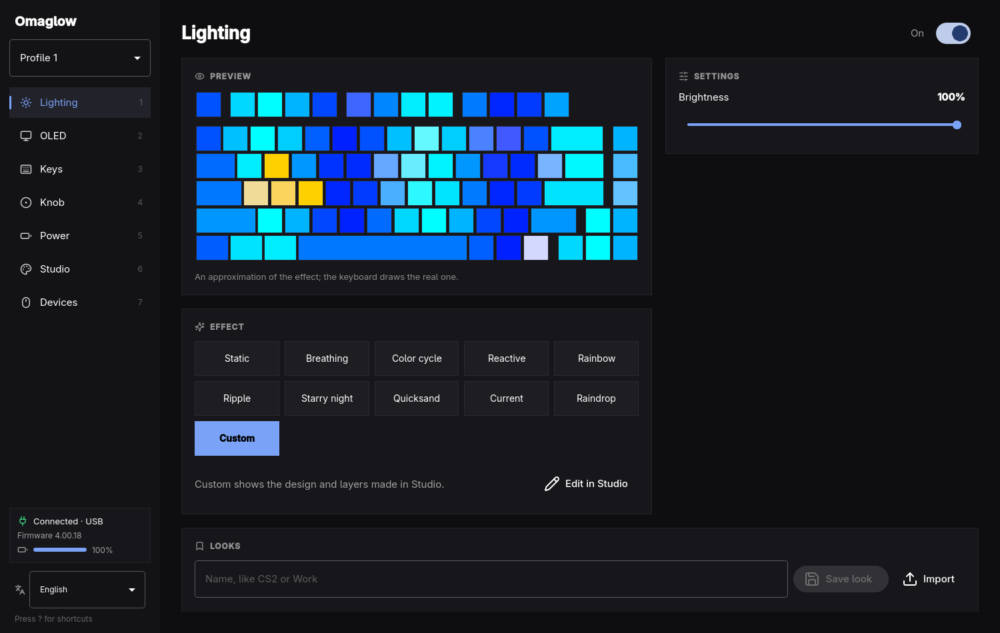

# Omaglow



Lighting and settings for your peripherals on [Omarchy](https://omarchy.org),
without Armoury Crate, Synapse or other vendor software. One app for the
keyboard, the mouse and the laptop, with looks that light all of them at once
and an option to follow the Omarchy theme.

Omaglow is a personal project, not affiliated with or endorsed by ASUS or
Razer. It sends the same settings and lighting commands the vendor software
sends and never updates or writes firmware. It is tested only on the devices
below; others may not work, and support is best effort.

## Supported devices

| Device | What Omaglow does | How |
|---|---|---|
| ASUS ROG Azoth (cable 0b05:1a83, 2.4 GHz dongle 1a85, ROG Omni receiver 1ace) | Lighting, per-key design and animated layers, OLED display, key remapping, control knob, power | The keyboard's vendor HID channel (hidraw) |
| Razer DeathAdder V2 (1532:0084) | Logo and scroll wheel lighting | HID feature reports (hidraw), as OpenRazer sends them |
| ASUS laptops with Aura keyboards (tested on a ROG Zephyrus G16 GU603VV) | Keyboard lighting | `asusctl` / asusd |

## ROG Azoth

Omaglow talks to the keyboard's own configuration channel, so changes are
stored on the keyboard and survive reboots and other computers.

- All ten lighting effects with brightness, speed, colors, direction, and
  thickness where the effect has them.
- Put any picture or GIF on the 208x64 OLED, pick one of the six built-in
  animations, and set the display's brightness or turn it off.
- Show a clock on the OLED. The keyboard has no clock of its own, so a small
  user service (`omaglow-clock.service`, running `omaglow clock`) sends it the
  time every minute, only while the clock is chosen.
- Show what is playing as spectrum bars (bars, mirrored, or line). A user
  service (`omaglow-music.service`, running `omaglow music`) records the default
  output's monitor with `parec`, only while the music display is chosen.
- Remap any key to another key, a media function, a mouse button, or Copilot,
  on a drawn keyboard; reset them all at once.
- Choose which functions the control knob switches between, and what its
  custom function does when turned up, pressed, or turned down.
- Five profiles plus the default one, each with its own lighting, keys and
  knob, picked from the sidebar (Fn + 1–6 on the keyboard switches too).
- Paint your own lighting key by key in Studio: any color per key, fill,
  random colors, clear. Each profile keeps its own design, drawn in the
  keyboard's direct mode (not stored on the keyboard, so the app draws it
  again after a profile switch or reconnect).
- Layers in Studio, as in Aura Creator: groups of keys with their own effect
  (Static, Breathing, Strobing, Color cycle, Rainbow, Starry night, Comet,
  Tide, Current, and Omaglow's Fire, Plasma, Scanner, Fireflies, Heartbeat
  and Gradient) in one color, two colors or random colors, drawn over the
  design, layers to the right on top. Shockwave (a drum flash and rings from the bottom row on
  a double beat) and Embers (sparks rising) blend over the layers under them
  instead of covering them.
- Live layers that show what is going on:
  - Music: spectrum bars from the default audio output (`parec`).
  - Workspaces: on the number keys, Hyprland workspaces with windows in one
    color and the active one in another, for the focused monitor's block of
    ten (Omarchy gives each monitor its own 1-10).
  - Meter: CPU load, CPU temperature or the laptop's battery as a bar.
  - Notifications: the keys blink when a notification comes (`dbus-monitor`;
    only that one came is used).
  - Timer: the keys go dark one by one over 5–60 minutes, then blink; started
    and stopped from Studio.
  - Typing: ripples from the keys you press, read from the keyboard's own key
    interface; kept a few seconds in memory, never stored or sent.

  Each source runs only while a layer that needs it is shown. Moving layers are streamed with 20 ms
  between reports by a user service (`omaglow-lights.service`, running
  `omaglow lights`) that the app starts while they are shown; on
  battery this keeps the keyboard's radio busy, and the stream pauses while
  the keyboard sleeps.
- Looks: save the current lighting (an effect or a Studio design) with a name
  and bring it back later; the one showing now is marked, and starred ones
  are listed first. Export a look to a
  `.json` file and import look files, to move looks between computers or share
  them (see Look files below).

Limits: the keyboard can't report its settings back, so the app shows the last
ones it sent, and there are no hardware macros (firmware 4.00.18 doesn't have
them).

## Devices and theme

- Devices: the laptop keyboard through asusctl (static, breathing, rainbow,
  rainbow wave, speed, direction, brightness) and the Razer DeathAdder V2's
  logo and scroll wheel (off, static, breathing with one or two colors,
  spectrum, brightness, stored on the mouse); both are saved with looks.
- Follow the Omarchy theme: on a theme change the keyboard, mouse and laptop
  take the theme's keyboard color (`keyboard.rgb`, which Omarchy renders from
  the accent unless the theme ships its own). With the app closed, the
  `theme-set` hook `~/.config/omarchy/hooks/theme-set.d/50-omaglow` (written
  when the option is turned on, removed when it is turned off) runs
  `omaglow theme-sync`.
- Set how long the keyboard waits before sleeping, the battery level for
  the lighting alert, power saving, and the key debounce time.
- Works over the USB cable and the ROG Omni receiver; follows the Omarchy theme
  and language (English and Spanish), or a language picked in the sidebar for
  Omaglow only.

## Look files

A look exported from Looks is a JSON file that can be read and edited by hand:

```json
{
  "omaglow": "look",
  "version": 1,
  "name": "Horde",
  "keyboard": {
    "on": true,
    "custom": true,
    "brightness": 100,
    "effect": { "name": "static", "speed": "normal", "colors": "single",
                "color1": "#ff0000", "color2": "#ff00ff", "direction": -1, "thickness": "thick" },
    "studio": {
      "design": { "61": "#ff0000" },
      "layers": [
        { "name": "War drums", "effect": "shockwave", "speed": "normal",
          "color1": "#ffffff", "color2": "#ffcc00", "random": false, "keys": [61, 110] }
      ]
    }
  },
  "mouse": { "logo": { "effect": "breathing", "color1": "#ff0000", "color2": "#ff8000",
                       "twoColors": true, "brightness": 100 } },
  "laptop": { "effect": "breathe", "color1": "#ff0000", "color2": "#ffaa00",
              "speed": "slow", "direction": "right", "brightness": "high" }
}
```

- Effects go by name: the keyboard's (`static`, `breathing`, `color-cycle`,
  `reactive`, `rainbow`, `ripple`, `starry-night`, `quicksand`, `current`,
  `raindrop`), the layers' (`static`, `breathing`, `strobing`, `color-cycle`,
  `rainbow`, `starry-night`, `comet`, `tide`, `current`, `fire`, `plasma`,
  `scanner`, `fireflies`, `heartbeat`, `gradient`, `music`, `workspaces`,
  `meter`, `notifications`, `timer`, `typing`, `shockwave`, `embers`), the
  mouse's (`off`, `static`, `breathing`, `spectrum`) and the laptop's
  (`static`, `breathe`, `rainbow-cycle`, `rainbow-wave`).
- Keys are the keyboard's key numbers (Esc is 110, the space bar 61). A meter
  layer adds `"source": "cpu" | "temperature" | "battery"`, a timer layer
  `"minutes"`.
- Without `mouse` or `laptop`, applying the look leaves them as they are.
- Importing refuses files that aren't looks or come from a newer Omaglow, and
  drops what it can't use inside a look (unknown keys or layer effects,
  colors that aren't colors). A name already in use gets " (2)".

## Install

On Omarchy (Arch Linux) with Qt 6:

```sh
bin/install
```

It builds the app, installs it as the `omaglow` package (binary, launcher entry,
user services, udev rules) and reloads udev, so the logged-in user can reach the
keyboard and the mouse without root. `asusctl` is only needed for the laptop
keyboard.

Upgrading from azoth, its earlier name: the package replaces it, the settings
are copied from `~/.config/azoth/azoth.conf` (left in place) on the first run,
and its services and theme hook move to the new names.

## Shortcuts

| Key | Action |
|---|---|
| `1` – `7` | Lighting, OLED, Keys, Knob, Power, Studio, Devices |
| `Space` | Lighting on or off |
| `↑` `↓` | Previous or next effect |
| `←` `→` | Brightness down or up (Lighting and OLED) |
| `S` | Change speed |
| `O` | Open a picture for the display |
| `R` | Look for the keyboard again |
| `?` | Show or hide shortcuts |
| `Q` | Quit |

## Credits

- The Razer protocol (report layout, CRC, transaction id and effect commands)
  follows [OpenRazer](https://github.com/openrazer/openrazer)'s driver; no
  OpenRazer code is included.
- Icons in `src/icons` are from [Lucide](https://lucide.dev) 0.460.0, under the
  ISC license in `src/icons/LICENSE`.
- The OLED's six built-in animations are drawn by the keyboard itself; Omaglow
  does not ship ASUS's artwork, so it shows them by number.

ASUS, ROG, Aura and Armoury Crate are trademarks of ASUSTeK Computer Inc.;
Razer, DeathAdder, Synapse and Chroma are trademarks of Razer Inc. Omaglow is
not affiliated with or endorsed by either company.

## Develop

```sh
bin/build           # build/omaglow
bin/test            # Qt Test, offscreen
bin/check-version   # VERSION and both PKGBUILDs' pkgver agree
```

CI (`.github/workflows/ci.yml`) runs these three on Arch Linux for every push
and pull request. `main` takes only commits whose CI build passed: push a
branch, wait for the check, then fast-forward `main`.

To release a version: write it in `VERSION` and in the `pkgver` of
`pkgbuild/PKGBUILD` and `aur/PKGBUILD`, move the Unreleased notes in
`CHANGELOG.md` under it, and tag the commit `vX.Y.Z`. Then, in `aur/`, put the
output of `makepkg -g` in `sha256sums` and run
`makepkg --printsrcinfo > .SRCINFO`.

`pkgbuild/PKGBUILD` builds this checkout (`bin/install`); `aur/PKGBUILD` builds
a released tag from GitHub, for the AUR.

The protocol was reverse engineered from Armoury Crate USB captures; the packet
builders in `src/protocol.cpp` are tested against the captured bytes.

## License

MIT, see `LICENSE`. The Lucide icons are ISC.
